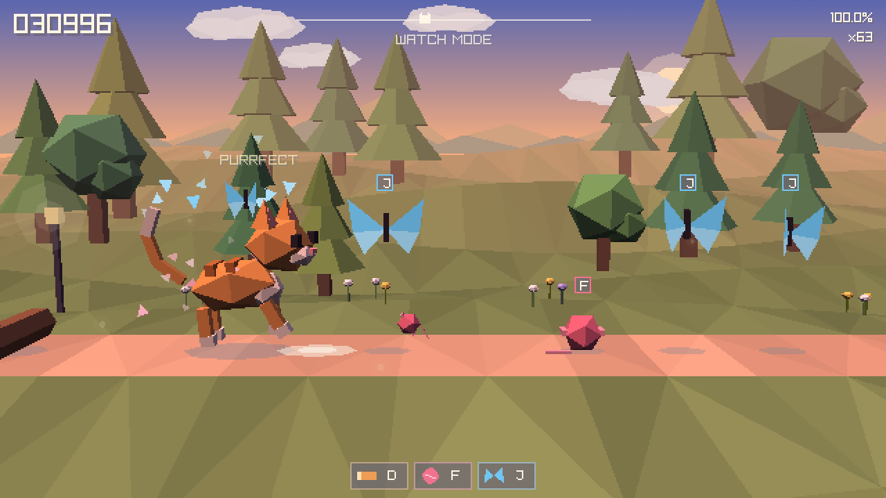
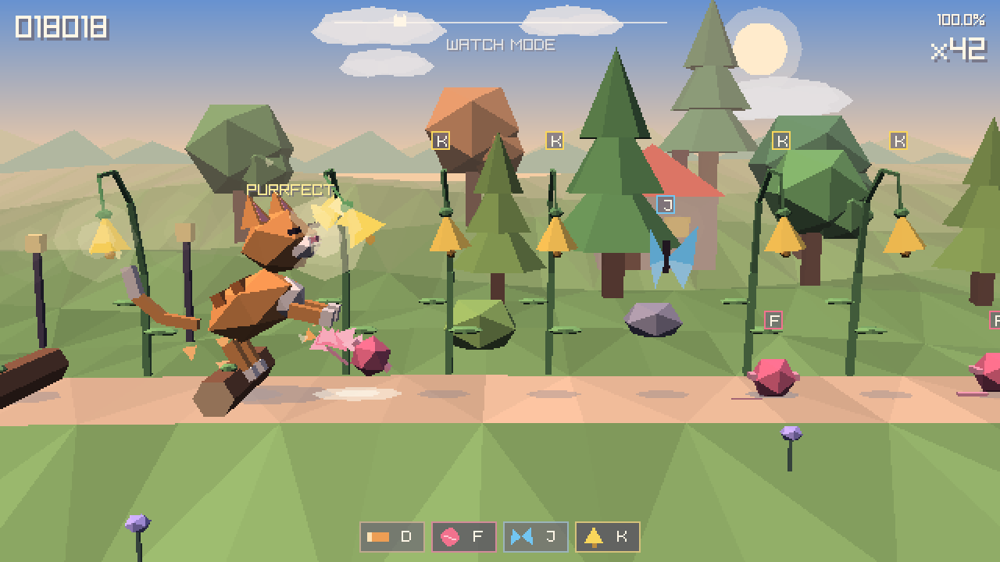
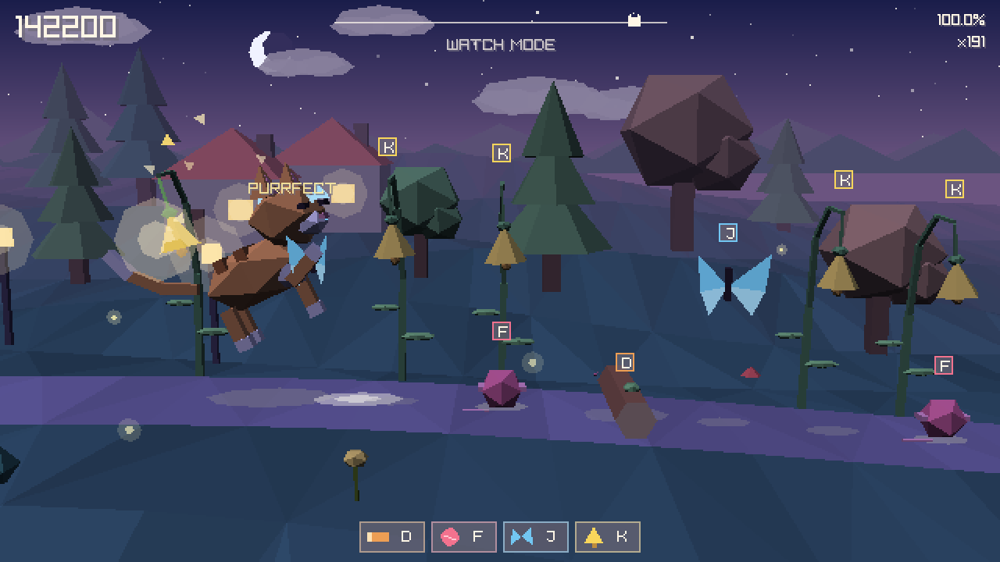

# ONIRIA

A cozy, low-poly rhythm game. Give it a song and a cat takes a walk along a path built from that song: every beat puts something on the path to play with, and the afternoon turns into night by the time the music ends.

Native C++ with [raylib](https://www.raylib.com/). Open source under the MIT license.



| Afternoon | Night |
| --- | --- |
|  |  |

> **Status: first prototype.** The whole loop works (load a song, play, results), but it has only been checked with automated runs so far. See [what is verified](#what-is-verified-so-far).

## How it plays

The cat walks by itself. Things appear on the path in time with the music, and each kind is answered with its own key, pressed when the cat reaches it:

| Key | Action | For |
| --- | --- | --- |
| `D` | Hop | Logs lying across the path |
| `F` | Bat | Balls of yarn |
| `J` | Swat | Butterflies |
| `K` | Ring | Bellflowers arching over the path |

A soft spot of light just ahead of the cat marks where each thing should be answered. The arrow keys work too (left, down, up, right). `Esc` pauses, `F11` toggles fullscreen.

There are three difficulties. **Cozy** only uses hop and bat, **Playful** adds butterflies, and **Zoomies** uses all four and sometimes asks for two at once.

Other options on the song screen:

- **Walking speed**: how fast the world scrolls, which is also how much warning you get.
- **Audio offset**: raise it if things reach the cat before you hear the beat (Bluetooth headphones usually need this).
- **Watch mode**: the cat plays by itself, if you just want to look and listen.
- **Key hints**: shows the key above each upcoming object.

## Loading music

Drop an audio file on the window, use **Open a song**, or pass the file on the command line (`oniria.exe song.mp3`). MP3, OGG, WAV and QOA are supported. Nothing is uploaded anywhere; the file is decoded and analyzed on your machine, which takes well under a second for a normal song.

There is also a built-in demo track, synthesized at startup, so the game is playable without any file.

## Building (Windows)

You need Visual Studio 2022 (or the Build Tools) with the "Desktop development with C++" workload.

```bat
build.bat
```

The first run downloads the prebuilt raylib 6.2 release into `third_party/` (checked against a pinned SHA-256) and then compiles `build\oniria.exe`, a single executable of about 1 MB with no other files to ship.

Other platforms are not set up yet. The game code is portable; `src/platform_win.cpp` holds the Windows-only parts (file dialog, low-latency keyboard) next to stubs for everything else.

## How it works

Short version:

1. **Listening.** The song is decoded to memory and analyzed once: a spectral-flux onset detector finds the moments where something starts (a kick, a snare, a note), in three frequency bands.
2. **Charting.** The strongest onsets become objects on the path, spaced according to the difficulty. Which object you get follows the pitch of the sound, so similar sounds tend to ask for the same key.
3. **Landscape.** The path's hills are the song's loudness over time, and the time of day follows the song's progress.
4. **Timing.** Audio is fed from a callback that timestamps each buffer, and on Windows key presses are timestamped by a dedicated raw-input thread, so hits are judged against where the music actually is, not against the frame rate.
5. **Drawing.** Everything is flat-shaded triangles lit on the CPU and drawn into a 360-line canvas that is scaled up by whole pixels.

The long version is in [docs/how-it-works.md](docs/how-it-works.md), and the story of how the project got here is in [docs/devlog.md](docs/devlog.md).

## What is verified so far

- The analysis is tested against the demo track, whose notes sit on a known grid: detected onsets land 3 ms from the grid on average (`oniria.exe --selftest`).
- Every screen has been rendered offscreen with a simulated clock and inspected (`oniria.exe --shot out.png --view play --at 20`).
- The real game starts, opens the audio device and runs.

Not yet verified by a person playing: how the timing feels with real key presses and real audio output, the default latency value, and how well the charts fit music other than the demo track.

## Project layout

```
src/main.cpp          game loop, renderer, UI
src/analysis.cpp      onset detection, chart generation, demo track
src/platform_win.cpp  file dialog, raw keyboard input
scripts/              dependency download
docs/                 design notes and devlog
```

## Credits

- [raylib](https://github.com/raysan5/raylib) by Ramon Santamaria and contributors (zlib license).

## License

[MIT](LICENSE)
