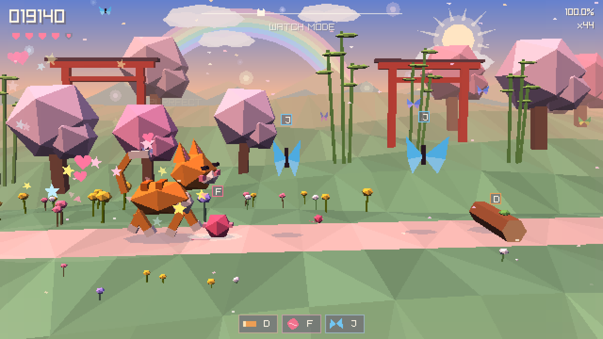
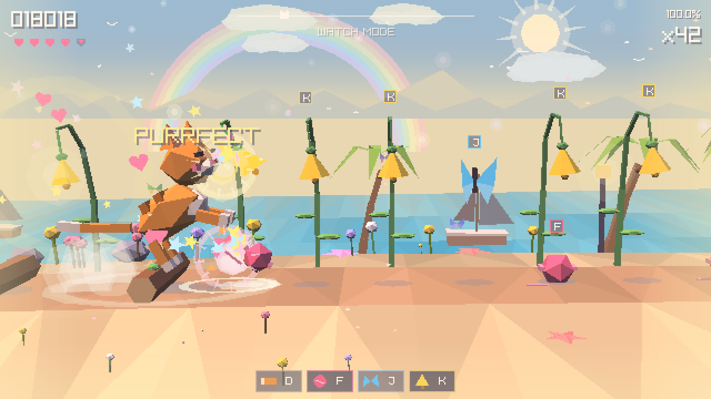
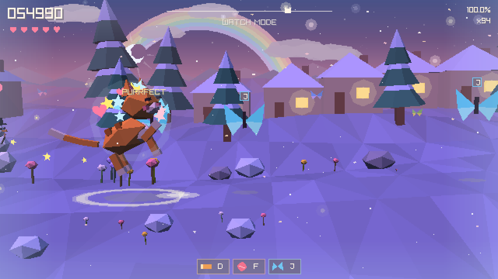
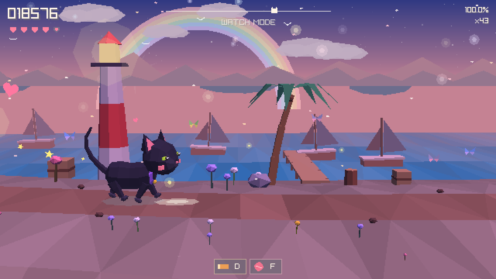

# ONIRIA

A cozy, low-poly rhythm game. Give it a song and a cat takes a walk along a path built from that song: every beat puts something on the path to play with, the walk passes through meadows, gardens, woods, snow and seaside, and the afternoon turns into night by the time the music ends.

Native C++ with [raylib](https://www.raylib.com/). Open source under the MIT license.


| Blossom garden | Seaside |
| --- | --- |
|  |  |
| **Autumn woods** | **Snowy village** |
|  |  |

> **Status: first prototype.** The whole loop works (load a song, play, results), but it has only been checked with automated runs so far. See [what is verified](#what-is-verified-so-far).

## How it plays

The cat walks by itself. Things appear on the path in time with the music, and each kind is answered with its own key, pressed when the cat reaches it:

| Key | Action | For |
| --- | --- | --- |
| `D` | Hop | Logs lying across the path |
| `F` | Bat | Balls of yarn |
| `J` | Swat | Butterflies |
| `K` | Ring | Bellflowers arching over the path |

A soft spot of light just ahead of the cat marks where each thing should be answered. The arrow keys work too (left, down, up, right). `Esc` pauses, `F11` toggles fullscreen.

### Streaks

Every hit in a row makes the walk happier, and a miss calms it back down:

- A **perfect** hit always gets a twinkle, a burst of stars, a ring of light on the path and two new flowers.
- As the streak grows the cat prances, blushes and gives off hearts, flowers spring up ahead of it, the trees dance harder, lamps come on, soft lights and petals drift through the sky, and eventually a rainbow comes out.
- The five hearts under the score show the current mood. Streaks of 10, 25, 50 and 100 get a banner and a little fanfare.

### Cats

Seven cats share the walk: Mango the orange tabby, Domino the tuxedo, Mochi the calico, Luna the siamese, Pebble the british blue, Cloud the fluffy white one and Midnight the black cat. They differ in coat pattern, colours, eye colour and a few proportions, and all of them are built like kittens: a big head, big low-set eyes, rosy cheeks, whiskers, a short body and stubby legs with round paws.

### Wardrobe and unlocks

The **Wardrobe** (from the main menu, or `C`) brings the camera in close and lets you choose the cat and what it wears: something on its head, around its neck and on its back. You start with three cats, a bow and a bell collar. Everything else is earned by playing, and each item says what it is waiting for and how far along you are:

| Earned by | Unlocks |
| --- | --- |
| Finishing songs | Bow tie (1), Luna (3), Balloon (5), Midnight (6), Headphones (10) |
| Purrfect hits, in total | Flower crown (50), Scarf (150), Pebble (300) |
| Your best streak | Party hat (25), Bandana (40), Cloud (60), Wings (100) |
| Ranks | Top hat (an A), Crown (an S), Halo (a song with no misses) |
| Places walked through | Straw hat (seaside), Beanie (snowy village), Witch hat (autumn woods), Flower garland (blossom garden) |
| Time spent walking | Backpack (10 minutes) |

Nothing is bought and nothing is random. Watch mode does not count. The results screen tells you what a walk unlocked, or what is next within reach.

| Flower crown | Beanie, scarf and balloon |
| --- | --- |
|  |  |

### Settings

**Settings** (from the main menu, the song screen, or `S`) has four tabs: **Sound** (music volume, effects volume, audio offset), **Game** (walking speed, key hints, how much the camera and screen effects move: still, gentle or full), **Display** (fullscreen, frame rate: 60, 120 or as fast as the display) and **Progress** (your lifetime numbers, and a reset).


### Camera and impact

Every hit moves the camera in its own way: it bounces with a hop, lunges with a bat, tips with a swat and sways with a bell, then settles within a quarter of a second. It also breathes with the kick drum and leans in for streak milestones. On screen each hit throws out streaks from where it landed, a ring bursts towards you, and the edges of the frame glow in the colour of that action. Bells send out rings of sound, hops kick up dust.

### Places

The walk passes through five places, each with its own ground, plants, props, weather and horizon, and each in three variations:

| Place | Variations | On the horizon |
| --- | --- | --- |
| Meadow | flower fields with a windmill, farmland with fences, crops and a barn, a riverside with ducks and wooden bridges | hot-air balloons |
| Blossom garden | a garden of stone lanterns and bamboo, a stream with red bridges and koi, a lantern festival with stalls | a great snow-capped mountain |
| Autumn woods | deep woods, a pumpkin patch watched by a scarecrow, a harvest village with smoking chimneys | birds flying south |
| Snowy village | a village of cabins and snowmen, a frozen river with igloos, a pine forest under the aurora | a range of white peaks |
| Seaside | a beach with umbrellas and sandcastles, a harbour with a pier and a lighthouse, a rocky cove with crabs | low islands |

By default a song is a journey: it starts in a place picked by the song's name and moves on roughly every half minute, blending from one to the next, so a place you come back to shows a different side. The song screen lets you stay in a single place instead, and then its three variations take turns.

| Lantern festival | Harbour |
| --- | --- |
|  |  |
| **Pumpkin patch** | **Riverside** |
|  |  |

### Your songs

Every song you open is remembered on the shelf in the main menu, most recent first, with its length and your best rank. Click one (or use the arrow keys and Enter) to play it again; Delete forgets it without touching the file. The list lives in `oniria.songs` next to the executable.

### Sound

Each action has its own soft instrument (marimba for logs, a round "bloop" for yarn, kalimba for butterflies, a small bell for bells), and the note climbs a pentatonic scale as the streak grows, so a good run plays a tune over the song. Everything is synthesized at startup; there are no audio files. The volume is on the song screen, and `oniria.exe --sfx-demo out.wav` writes a short audition.

### Difficulty

There are three difficulties. **Cozy** only uses hop and bat, **Playful** adds butterflies, and **Zoomies** uses all four and sometimes asks for two at once.

The song screen also has **Watch mode**, where the cat plays by itself if you just want to look and listen, and the scenery choice. Walking speed and audio offset live in Settings; raise the offset if things reach the cat before you hear the beat (Bluetooth headphones usually need this).
- **Key hints**: shows the key above each upcoming object.

## How light it is

Measured on Windows with the release build:

| | |
| --- | --- |
| Executable | 1.2 MB, no other files to ship |
| Memory | 65 to 75 MB with the menu open, plus roughly 10 MB per minute of the loaded song |
| CPU, menu open | 6 to 10% of one core (about 3% of that is the audio device thread) |
| CPU, minimized | about 5% of one core; nothing is drawn |
| Frame cost | about 1.4 ms of CPU per frame; the 3D scene is drawn into a 640x360 canvas |

Frames are capped at 120 per second while playing, 60 in menus and 30 when the window is not focused. Songs are analyzed in about a tenth of a second per minute of music.

## Loading music

Drop an audio file on the window, use **Open a song**, or pass the file on the command line (`oniria.exe song.mp3`). MP3, OGG, WAV and QOA are supported. Nothing is uploaded anywhere; the file is decoded and analyzed on your machine, which takes well under a second for a normal song.

There is also a built-in demo track, synthesized at startup, so the game is playable without any file.

## Building (Windows)

You need Visual Studio 2022 (or the Build Tools) with the "Desktop development with C++" workload.

```bat
build.bat
```

The first run downloads the prebuilt raylib 6.2 release into `third_party/` (checked against a pinned SHA-256) and then compiles `build\oniria.exe`, a single executable of about 1 MB with no other files to ship.

Other platforms are not set up yet. The game code is portable; `src/platform_win.cpp` holds the Windows-only parts (file dialog, low-latency keyboard) next to stubs for everything else.

## How it works

Short version:

1. **Listening.** The song is decoded to memory and analyzed once: a spectral-flux onset detector finds the moments where something starts (a kick, a snare, a note), in three frequency bands.
2. **Charting.** The strongest onsets become objects on the path, spaced according to the difficulty. Which object you get follows the pitch of the sound, so similar sounds tend to ask for the same key.
3. **Landscape.** The path's hills are the song's loudness over time, and the time of day follows the song's progress.
4. **Timing.** Audio is fed from a callback that timestamps each buffer, and on Windows key presses are timestamped by a dedicated raw-input thread, so hits are judged against where the music actually is, not against the frame rate.
5. **Drawing.** Everything is flat-shaded triangles lit on the CPU and drawn into a 360-line canvas that is scaled up by whole pixels.

The long version is in [docs/how-it-works.md](docs/how-it-works.md), and the story of how the project got here is in [docs/devlog.md](docs/devlog.md).

## What is verified so far

- The analysis is tested against the demo track, whose notes sit on a known grid: detected onsets land 3 ms from the grid on average (`oniria.exe --selftest`).
- Every screen has been rendered offscreen with a simulated clock and inspected (`oniria.exe --shot out.png --view play --at 20`).
- The real game starts, opens the audio device and runs.

Not yet verified by a person playing: how the timing feels with real key presses and real audio output, the default latency value, how the sound effects actually sound (they have only been checked for level and length), and how well the charts fit music other than the demo track.

## Project layout

```
src/main.cpp          game loop, renderer, UI
src/analysis.cpp      onset detection, chart generation, demo track
src/sfx.cpp           synthesized sound effects
src/platform_win.cpp  file dialog, raw keyboard input
scripts/              dependency download
docs/                 design notes and devlog
```

## Credits

- [raylib](https://github.com/raysan5/raylib) by Ramon Santamaria and contributors (zlib license).

## License

[MIT](LICENSE)
