# ONIRIA

A cozy, low-poly rhythm game. Give it a song and a cat takes a walk along a path built from that song: every beat puts something on the path to play with, the walk passes through meadows, gardens, woods, snow and seaside, and the afternoon turns into night by the time the music ends.

Native C++ with [raylib](https://www.raylib.com/). Open source under the MIT license.

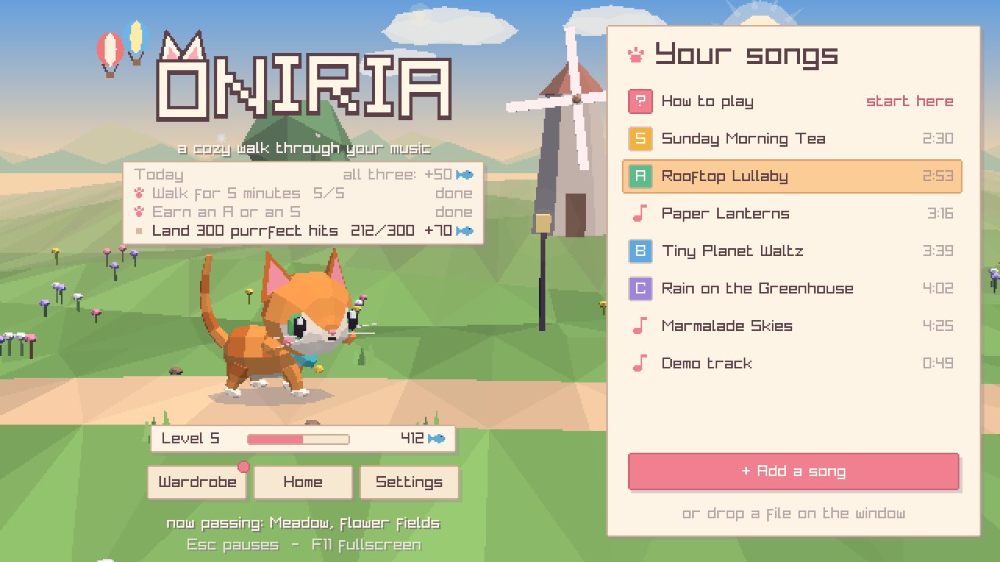

| Blossom garden | Seaside |
| --- | --- |
|  |  |
| **Autumn woods** | **Snowy village** |
| 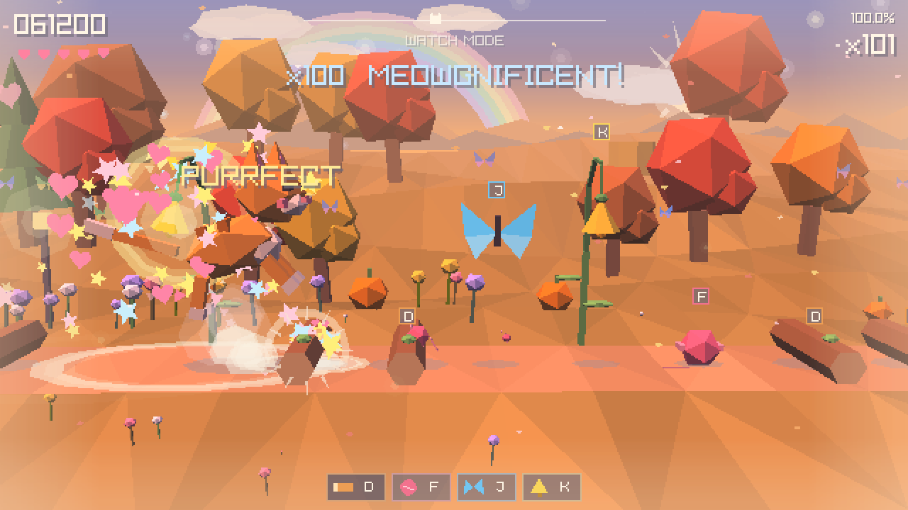 |  |

> **Status: first prototype.** The whole loop works (load a song, play, results), but it has only been checked with automated runs so far. See [what is verified](#what-is-verified-so-far).

## How it plays

The cat walks by itself. Things appear on the path in time with the music, and each kind is answered with its own key, pressed when the cat reaches it:

| Key | Action | For |
| --- | --- | --- |
| `D` | Hop | Logs lying across the path |
| `F` | Bat | Balls of yarn |
| `J` | Swat | Butterflies |
| `K` | Ring | Bellflowers arching over the path |

A soft spot of light just ahead of the cat marks where each thing should be answered. The arrow keys work too (left, down, up, right). `Esc` pauses, `F11` toggles fullscreen.

**Long yarn.** Now and then, where the music holds a sound, a ball of yarn comes with a thread trailing behind it. Bat it with `F` and keep the key down while the cat reels the thread in. Holding to the end is a bonus; letting go early costs nothing but that bonus. Stretches of music that never let up also get a short breather.

**New here?** *How to play* at the top of the song shelf is a guided walk: one part for each key, then all four together, then long yarn, with a line of advice on screen. If a part goes by mostly unanswered it is simply played again. Finishing it the first time pays 50 fish.

**Gamepad.** The first connected pad works alongside the keyboard: d-pad left and right are hop and bat, the left and right face buttons are swat and ring (the other d-pad and face buttons double them), and Start pauses. In menus the d-pad moves, the bottom face button accepts and the right one goes back.

| The guided walk | Long yarn |
| --- | --- |
| 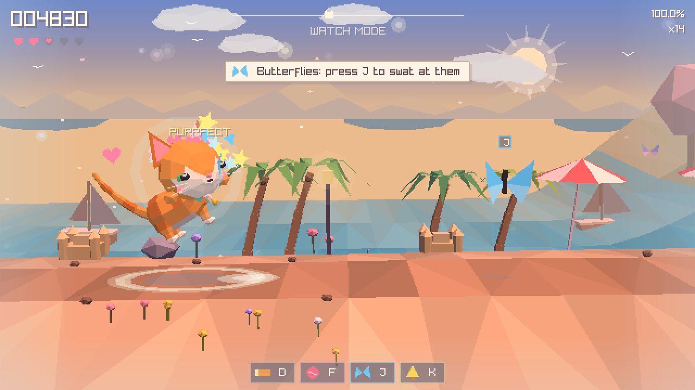 | 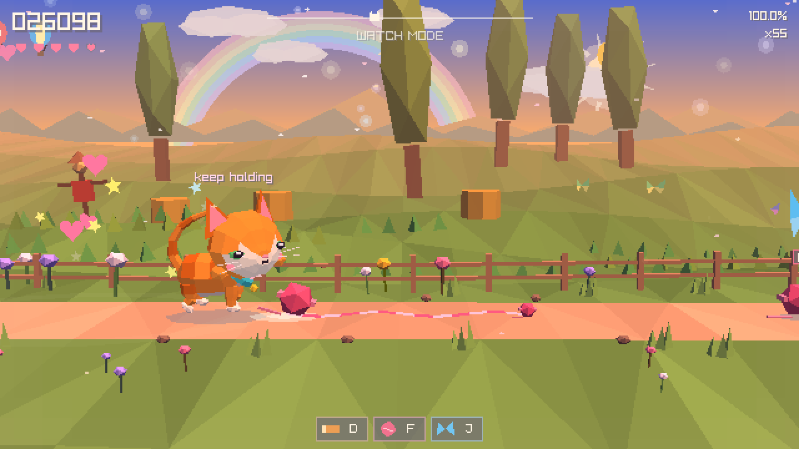 |

### Streaks

Every hit in a row makes the walk happier, and a miss calms it back down:

- A **perfect** hit always gets a twinkle, a burst of stars, a ring of light on the path and two new flowers.
- As the streak grows the cat prances, blushes and gives off hearts, flowers spring up ahead of it, the trees dance harder, lamps come on, soft lights and petals drift through the sky, and eventually a rainbow comes out.
- The five hearts under the score show the current mood. Streaks of 10, 25, 50 and 100 get a banner and a little fanfare.

### Cats

Seven cats share the walk: Mango the orange tabby, Domino the tuxedo, Mochi the calico, Luna the siamese, Pebble the british blue, Cloud the fluffy white one and Midnight the black cat. They differ in coat pattern, colours, eye colour and a few proportions, and all of them are built like kittens: a big head, big low-set eyes, rosy cheeks, whiskers, a short body and stubby legs with round paws.

### Fish, levels and the wardrobe

Every walk you finish pays two things:

- **Fish**, the currency. A walk pays more the longer the song and the better it went, a little more on harder difficulties, plus a bonus for the rank, for a walk with no misses and for a new best. A three-minute song played well pays around 100.
- **Experience**, which raises your **level**. Each level asks for a little more than the last, pays a few fish when you reach it, and some levels bring a reward that cannot be bought.

The **Wardrobe** (from the main menu, or `C`) brings the camera in close and lets you choose the cat and what it wears: something on its head, around its neck and on its back. You start with three cats, a bow and a bell collar. Select anything you do not own and the cat tries it on, so you can see it before spending.

| Bought with fish | |
| --- | --- |
| Hats | Flower crown (80), Straw hat (150), Beanie (150), Witch hat (250), Top hat (400) |
| Neck | Scarf (100), Bandana (120), Flower garland (200) |
| Back | Backpack (200), Balloon (300) |

| Level | Reward | Level | Reward |
| --- | --- | --- | --- |
| 2 | Bow tie | 10 | Cloud, the fluffy white cat |
| 3 | Luna, the siamese | 12 | Wings |
| 5 | Party hat | 15 | Midnight, the black cat |
| 6 | Pebble, the british blue | 18 | Crown |
| 8 | Headphones | 20 | Halo |

Nothing is random and nothing costs real money. Watch mode earns nothing. The results screen counts up what the walk paid, shows the level bar filling, and says what the next reward is. Your level and fish are always on the main menu.

| Trying on a hat before buying it | A walk that reached a new level |
| --- | --- |
| 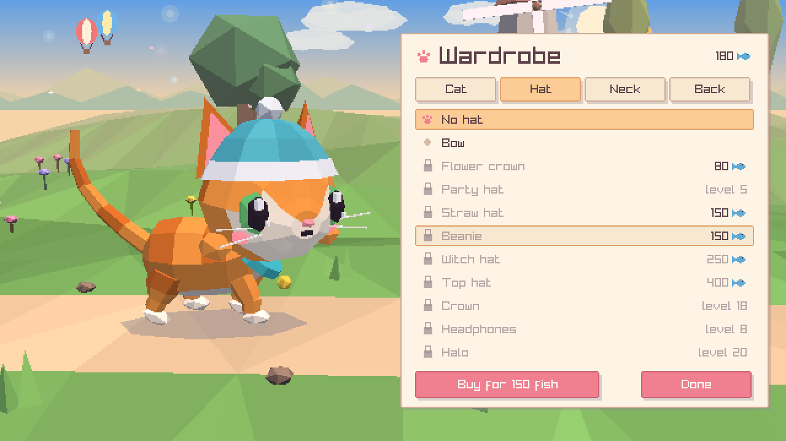 | 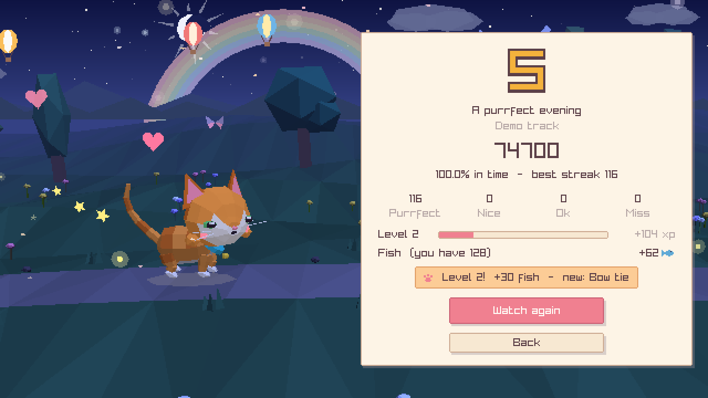 |

| Flower crown | Beanie, scarf and balloon | Straw hat, scarf and backpack |
| --- | --- | --- |
| 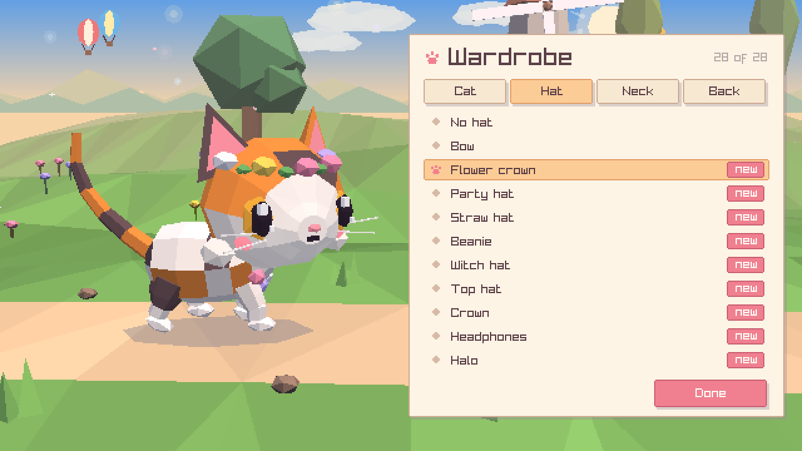 | 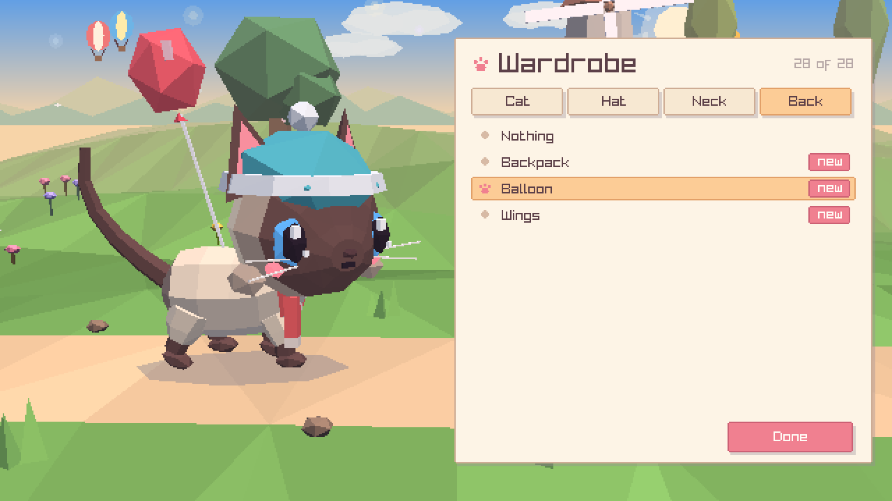 | 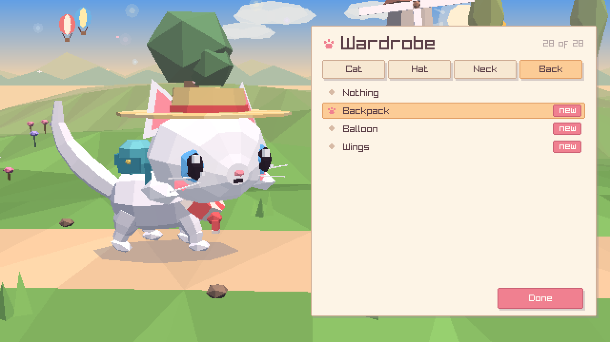 |

### Today's goals

Three small goals a day, on the main menu: finish a couple of walks, land so many purrfect hits, reach a streak, pass through a certain place, and so on. They are picked from the date, so they are the same all day and need no connection. Each pays fish once, and all three together pay 50 more.

### The cat's room

**Home** (from the main menu, or `H`) is a little room with seven spots: walls, rug, bed, plant, lamp, toys and something for the wall. Each has four choices; the first is free (the bed starts as a cardboard box, which every cat prefers anyway) and the rest are bought with fish, from 70 for a little cactus to 500 for the cat tree. Furnishing everything takes 4210 fish, so there is always something to save up for after the wardrobe is full. As in the wardrobe, selecting something you do not own shows it in the room first. The window shows the same sky as outside.

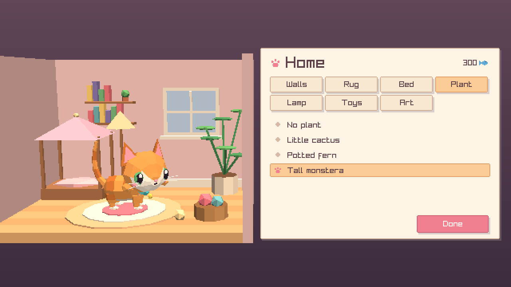

### Settings

**Settings** (from the main menu, the song screen, or `S`) has four tabs: **Sound** (music volume, effects volume, audio offset), **Game** (walking speed, key hints, how much the camera and screen effects move: still, gentle or full), **Display** (fullscreen, frame rate: 60, 120 or as fast as the display) and **Progress** (your lifetime numbers, and a reset).

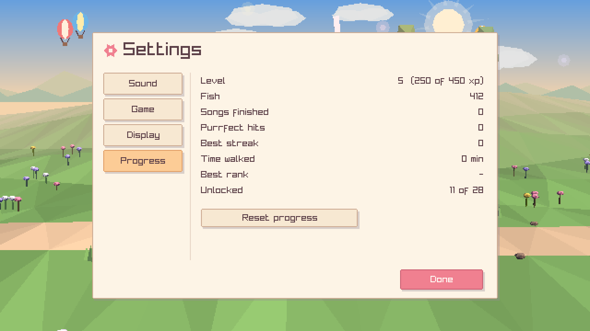

**Calibrate by ear** (Settings, Sound) sets the audio offset for you: a steady tick plays, you tap `D`, `F`, `J` or `K` along with it sixteen times, and the game measures how late your taps land. Do it once for each pair of headphones or speakers; Bluetooth usually needs it.

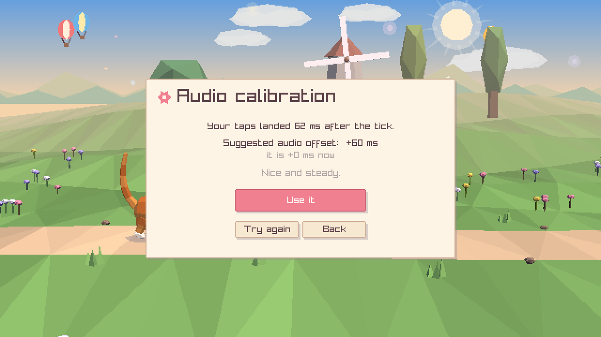

### Camera and impact

Every hit moves the camera in its own way: it bounces with a hop, lunges with a bat, tips with a swat and sways with a bell, then settles within a quarter of a second. It also breathes with the kick drum and leans in for streak milestones. On screen each hit throws out streaks from where it landed, a ring bursts towards you, and the edges of the frame glow in the colour of that action. Bells send out rings of sound, hops kick up dust.

### Places

The walk passes through five places, each with its own ground, plants, props, weather and horizon, and each in three variations:

| Place | Variations | On the horizon |
| --- | --- | --- |
| Meadow | flower fields with a windmill, farmland with fences, crops and a barn, a riverside with ducks and wooden bridges | hot-air balloons |
| Blossom garden | a garden of stone lanterns and bamboo, a stream with red bridges and koi, a lantern festival with stalls | a great snow-capped mountain |
| Autumn woods | deep woods, a pumpkin patch watched by a scarecrow, a harvest village with smoking chimneys | birds flying south |
| Snowy village | a village of cabins and snowmen, a frozen river with igloos, a pine forest under the aurora | a range of white peaks |
| Seaside | a beach with umbrellas and sandcastles, a harbour with a pier and a lighthouse, a rocky cove with crabs | low islands |

By default a song is a journey: it starts in a place picked by the song's name and moves on roughly every half minute, blending from one to the next, so a place you come back to shows a different side. The song screen lets you stay in a single place instead, and then its three variations take turns.

| Lantern festival | Harbour |
| --- | --- |
| 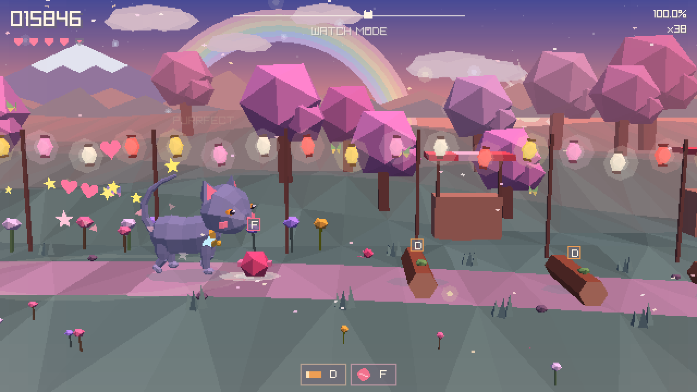 |  |
| **Pumpkin patch** | **Riverside** |
| 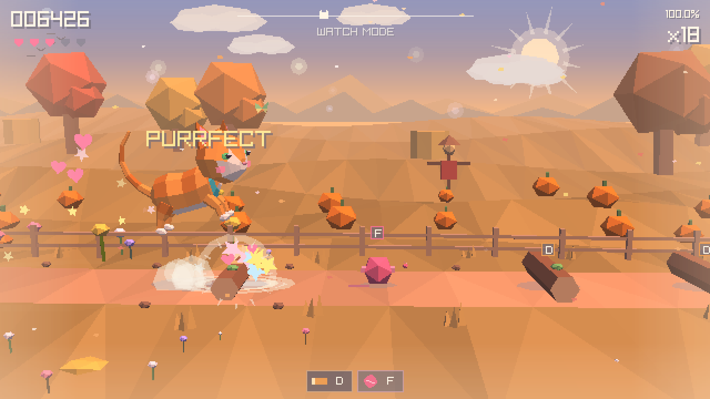 | 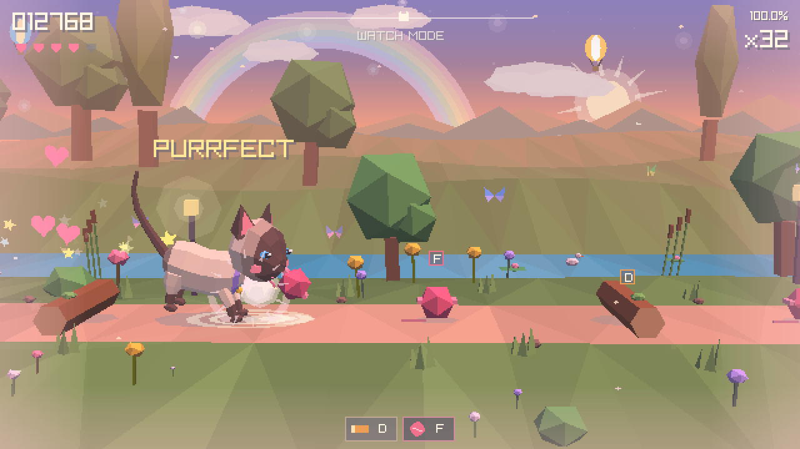 |

### Your songs

Every song you open is remembered on the shelf in the main menu, most recent first, with its length and your best rank. Click one (or use the arrow keys and Enter) to play it again; Delete forgets it without touching the file. The list lives in `oniria.songs` next to the executable.

### Sound

Each action has its own soft instrument (marimba for logs, a round "bloop" for yarn, kalimba for butterflies, a small bell for bells), and the note climbs a pentatonic scale as the streak grows, so a good run plays a tune over the song. Everything is synthesized at startup; there are no audio files. The volume is on the song screen, and `oniria.exe --sfx-demo out.wav` writes a short audition.

### Difficulty

There are three difficulties. **Cozy** only uses hop and bat, **Playful** adds butterflies, and **Zoomies** uses all four and sometimes asks for two at once.

The song screen also has **Watch mode**, where the cat plays by itself if you just want to look and listen, and the scenery choice. Walking speed and audio offset live in Settings; raise the offset if things reach the cat before you hear the beat (Bluetooth headphones usually need this).
- **Key hints**: shows the key above each upcoming object.

## How light it is

Measured on Windows with the release build:

| | |
| --- | --- |
| Executable | 1.2 MB, no other files to ship |
| Memory | 65 to 75 MB with the menu open, plus roughly 10 MB per minute of the loaded song |
| CPU, menu open | 6 to 10% of one core (about 3% of that is the audio device thread) |
| CPU, playing at 120 frames per second | roughly 10 to 15% of one core on Playful, 20 to 25% on Zoomies |
| Memory, playing | 80 to 90 MB with a song of under a minute loaded |
| CPU, minimized | about 5% of one core; nothing is drawn |
| Frame cost | about 1.4 ms of CPU per frame; the 3D scene is drawn into a 640x360 canvas |

Frames are capped at 120 per second while playing, 60 in menus and 30 when the window is not focused. Songs are analyzed in about a tenth of a second per minute of music.

## Loading music

Drop an audio file on the window, use **Open a song**, or pass the file on the command line (`oniria.exe song.mp3`). MP3, OGG, WAV and QOA are supported. Nothing is uploaded anywhere; the file is decoded and analyzed on your machine, which takes well under a second for a normal song.

There is also a built-in demo track, synthesized at startup, so the game is playable without any file.

## Getting it

Every push is built automatically by GitHub Actions; the Windows build of any commit can be downloaded from its run under the repository's **Actions** tab (`oniria-windows-x64`). Pushing a tag such as `v0.1.0` publishes a release with the same zip attached. It is one executable of about 1 MB, with nothing to install.

## Building

**Windows.** You need Visual Studio 2022 (or the Build Tools) with the "Desktop development with C++" workload.

```bat
build.bat
```

The first run downloads the prebuilt raylib 6.2 release into `third_party/` (checked against a pinned SHA-256) and then compiles `build\oniria.exe`.

**Linux (experimental).** With `g++`, `curl` and the X11 and OpenGL development packages installed:

```sh
sh build.sh
```

All the game code is shared, but the timestamped keyboard input and the file dialog exist only on Windows (`src/platform_win.cpp` holds them next to plain fallbacks). On Linux keys are read once a frame, and songs are opened by dropping a file on the window or passing its path on the command line.

## How it works

Short version:

1. **Listening.** The song is decoded to memory and analyzed once: a spectral-flux onset detector finds the moments where something starts (a kick, a snare, a note), in three frequency bands.
2. **Charting.** The strongest onsets become objects on the path, spaced according to the difficulty. Which object you get follows the pitch of the sound, so similar sounds tend to ask for the same key.
3. **Landscape.** The path's hills are the song's loudness over time, and the time of day follows the song's progress.
4. **Timing.** Audio is fed from a callback that timestamps each buffer, and on Windows key presses are timestamped by a dedicated raw-input thread, so hits are judged against where the music actually is, not against the frame rate.
5. **Drawing.** Everything is flat-shaded triangles lit on the CPU and drawn into a 360-line canvas that is scaled up by whole pixels.

The long version is in [docs/how-it-works.md](docs/how-it-works.md), and the story of how the project got here is in [docs/devlog.md](docs/devlog.md).

## What is verified so far

- **Analysis.** Tested against the demo track, whose notes sit on a known grid: detected onsets land 3 ms from the grid on average (`oniria.exe --selftest`).
- **Every screen** has been rendered offscreen with a simulated clock and inspected (`oniria.exe --shot out.png --view play --at 20`), including frame-by-frame sequences around hits.
- **The real game, end to end** (`oniria.exe --robot log.txt`). A test thread presses real keys through the operating system while the game runs normally with its volume at zero, then the game reports what it measured. Over four runs (a WAV file twice, the demo track on Playful and on Zoomies):

  | | |
  | --- | --- |
  | Key presses | 492 sent, 492 received through the raw input thread, none lost |
  | Input timing | the time the game assigns to a press is 0.5 ms from when it was sent on average, 1.5 ms at worst (logged on the last two runs, 306 presses) |
  | Judgement | all 492 hits were judged in the window their timing falls in; the 18 misses were exactly the 18 planned ones |
  | Audio | callback 100 times a second, the whole song delivered; the game clock stayed 0.2 ms from the audio thread on average (10 ms at its worst moment) and never had to resync |
  | Frames | 120 per second, 8.33 ms on average; at most two frames over 20 ms in a run |
  | Pause and resume | pauses on Esc, resumes on Enter, timing unaffected afterwards |
  | Saving | best score, library entry and lifetime progress written to disk and read back by the next run |
  | Fish and levels | a later run with the economy in place: the walk paid 41 fish and 96 experience, reached level 2 and its reward, then the test opened the wardrobe with real keys, tried a hat on and bought it (171 fish to 91); all of it was on disk afterwards |

- **What was added since**, each with its own end-to-end run (real key presses, real audio thread, volume at zero):

  | | |
  | --- | --- |
  | Calibration | taps sent 45 ms after each tick on purpose were measured as +45.5 ms and the game suggested +45 |
  | Guided walk | the first part was ignored on purpose and came round again; then everything was answered; the first-time 50 fish were paid once |
  | Today's goals | a walk that earned an A completed "earn an A or an S" and was paid its 50 fish; the day's numbers were on disk afterwards |
  | The cat's room | opened with `H`, showed a rug that was not owned, bought it with Enter (411 fish to 321), and it was placed and saved |
  | Long yarn | of five long notes in a walk, the three the test held to the end paid their bonus and the two it let go of early did not, with no penalty |

- **Sound effects** were measured rather than heard: no clipping, no DC offset, attacks of 3 to 13 ms (no clicks), and practically no energy above 4 kHz.

Still not verified, because it needs a person: how the timing *feels* (injected keys skip the keyboard itself, and the delay between the audio callback and the speakers cannot be measured from inside the program, which is what the audio offset setting is for), whether the sounds are pleasant, how well the charts fit music other than the two test tracks, and whether the prices and the level curve feel right. **Gamepad support has not been tried with a real pad**; it is written against raylib's standard mapping and nothing more. The automatic builds pass on both Windows and Linux, including the analysis self-test, but the Linux build has only been compiled and self-tested there: nobody has opened its window or played it.

## Project layout

```
src/main.cpp          game loop, renderer, UI
src/analysis.cpp      onset detection, chart generation, demo track
src/sfx.cpp           synthesized sound effects
src/platform_win.cpp  file dialog, raw keyboard input
build.bat, build.sh   Windows and Linux builds
.github/workflows/    automatic builds and releases
scripts/              dependency download
docs/                 design notes and devlog
```

## Credits

- [raylib](https://github.com/raysan5/raylib) by Ramon Santamaria and contributors (zlib license).

## License

[MIT](LICENSE)
